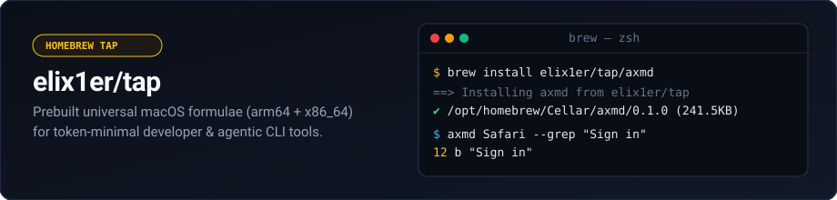

<div align="center">



<br/>

[](#quick-start)
[-000000?style=flat-square&logo=apple&logoColor=white)](#formulae)
[](#bundled-agent-skills)
[](https://github.com/elix1er/axmd/blob/main/LICENSE)

**Official Homebrew tap for [`elix1er`](https://github.com/elix1er) macOS developer and agentic CLI tools.**  
Prebuilt universal (`arm64` + `x86_64`) Mach-O binaries + portable `SKILL.md` bundles.

</div>

---

## Quick Start

```bash
brew install elix1er/tap/axmd
```

Or tap once and install by formula name:

```bash
brew tap elix1er/tap
brew install axmd
```

## Formulae

| Formula | Version | Arch | Description | Upstream |
| :--- | :---: | :---: | :--- | :--- |
| **[`axmd`](Formula/axmd.rb)** | `0.1.0` | `arm64` + `x86_64` | Token-minimal macOS Accessibility (`AXUIElement`) tree snapshot & headless `AXPress` CLI | [`elix1er/axmd`](https://github.com/elix1er/axmd) |

## Bundled Agent Skills

Formulae that ship with autonomous coding agent skills install them under Homebrew's `pkgshare` directory (`$(brew --prefix)/share/<formula>/skills/`).

To wire `axmd-computer-use` into your agent runtime after `brew install`:

```bash
SKILL_SRC="$(brew --prefix axmd)/share/axmd/skills/axmd-computer-use"

cp -R "$SKILL_SRC" ~/.codex/skills/     # OpenAI Codex
cp -R "$SKILL_SRC" ~/.claude/skills/    # Claude Code
cp -R "$SKILL_SRC" .agents/skills/      # Google Antigravity / Gemini
```

## Commands & Maintenance

```bash
brew update && brew upgrade axmd   # upgrade to latest release
brew test elix1er/tap/axmd         # run formula smoke check
brew uninstall axmd                # remove binary & pkgshare assets
```

## License

[MIT](https://github.com/elix1er/axmd/blob/main/LICENSE)
